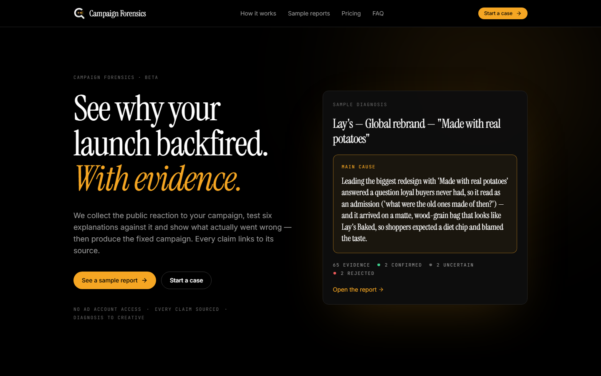
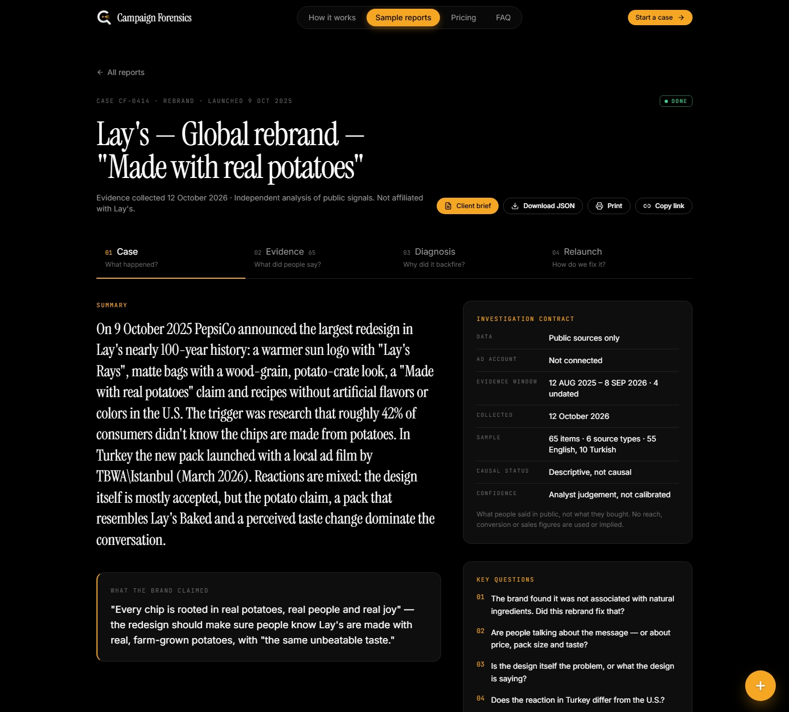
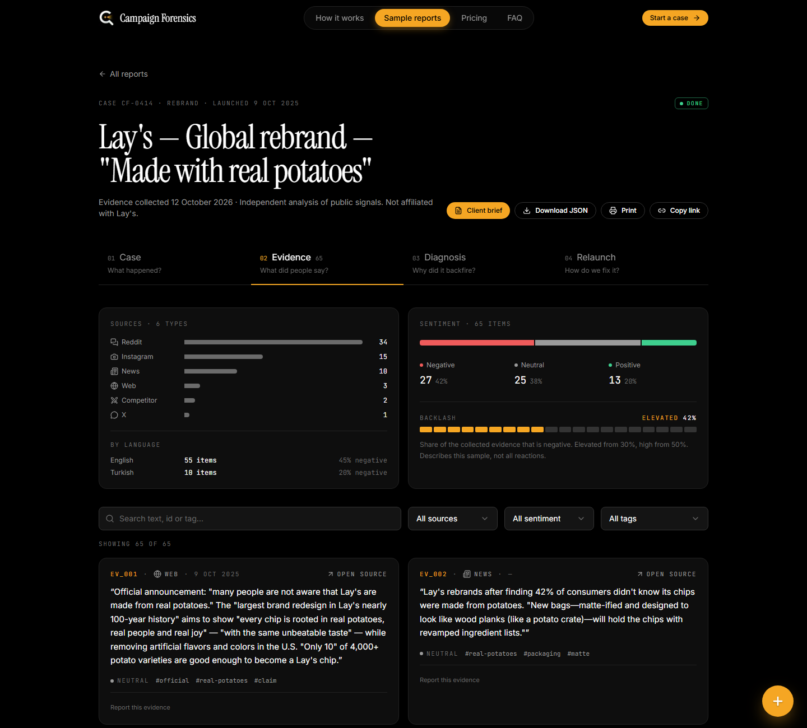
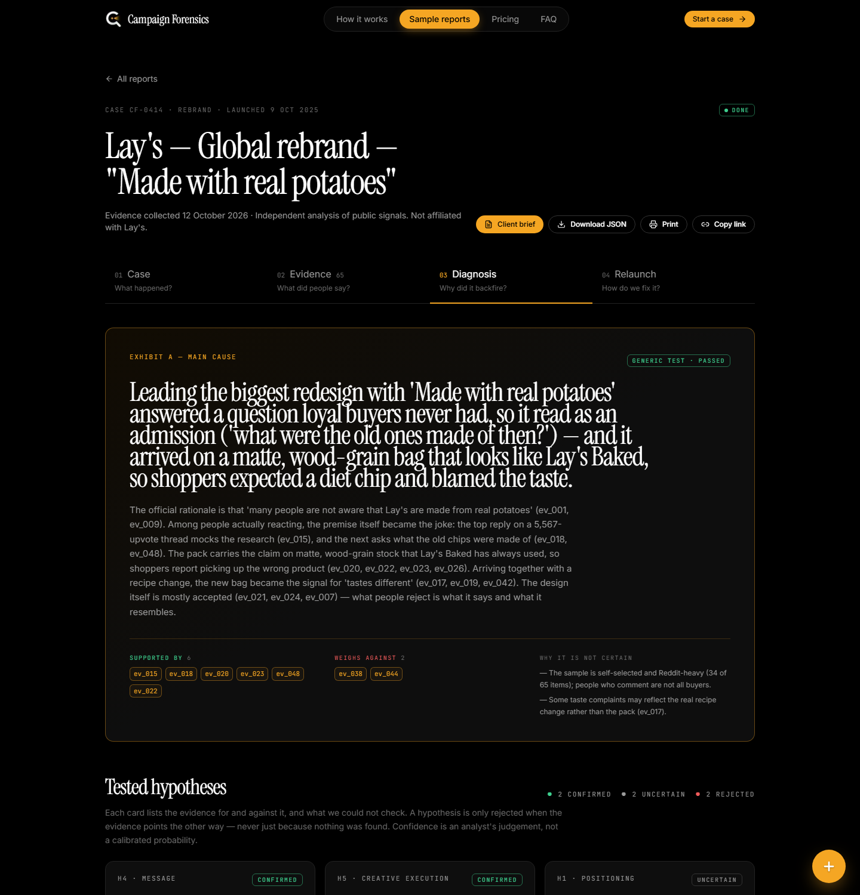
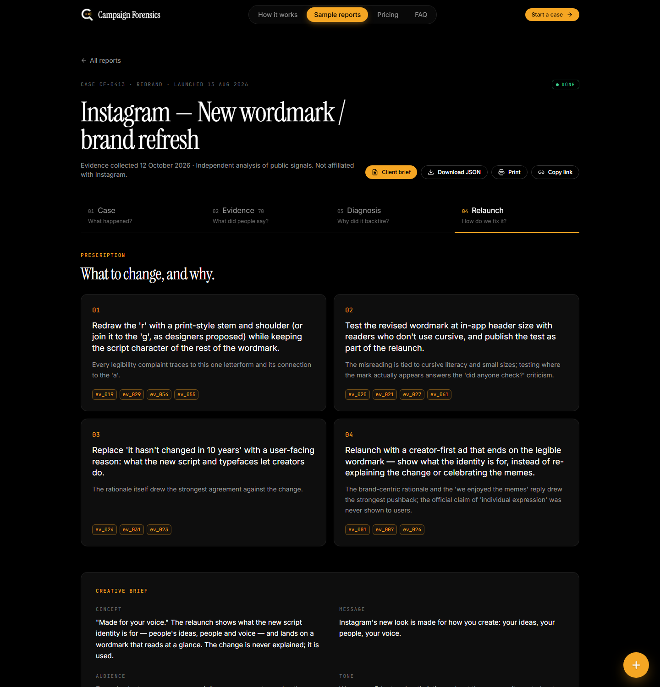
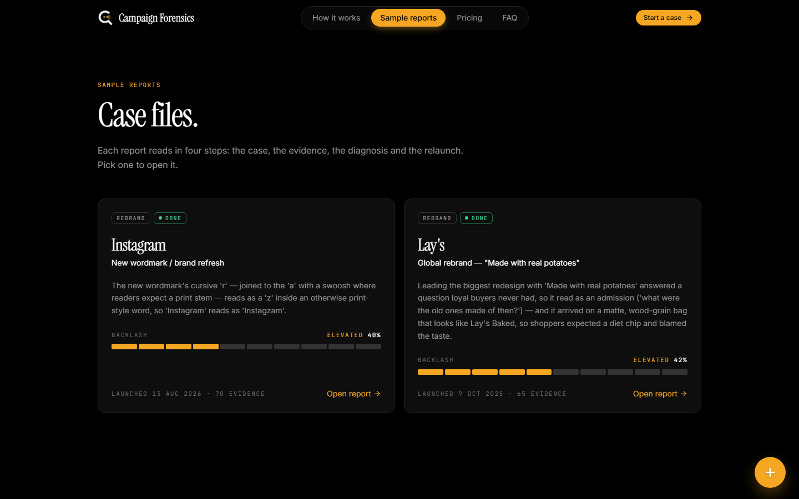
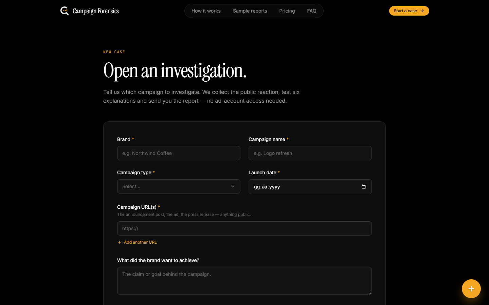
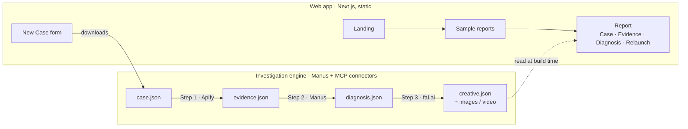

<div align="center">


# Campaign Forensics

**See why your launch backfired. With evidence.**

A campaign-diagnosis SaaS for agencies and brand teams. It collects the public reaction to a campaign,
tests six explanations against that evidence, names what actually went wrong — and produces the fixed campaign.

Built for the *10X Your Brand Hackathon* · Istanbul · 12 October 2026 · with Manus, Apify and fal.ai

**Runs locally** — no hosting, no accounts, no database. Clone, install, open `localhost:3000`.

</div>



---

## Contents

- [What it does](#what-it-does)
- [A tour of a report](#a-tour-of-a-report)
- [Sample cases](#sample-cases)
- [How it's built](#how-its-built)
- [Run it locally](#run-it-locally)
- [Project structure](#project-structure)
- [Data and contracts](#data-and-contracts)
- [Running the investigation engine](#running-the-investigation-engine)
- [Design](#design)
- [Responsible use](#responsible-use)

---

## What it does

| | |
|---|---|
| **No ad account access** | Works from public signals only: news, social comments, video, forums, competitor campaigns. |
| **Every claim is sourced** | Each conclusion links to the evidence behind it. Hypotheses that don't hold up are shown as rejected, not hidden. |
| **Diagnosis to creative, one flow** | The fix isn't a slide of recommendations — it's a brief plus a produced concept image and relaunch video. |

The spec — the single source of truth for scope and phases — is [`CAMPAIGN_FORENSICS.md`](CAMPAIGN_FORENSICS.md) (Turkish).

---

## A tour of a report

Every report reads in **four steps**. They appear as numbered tabs at the top of the report (they stay
visible while you scroll), and each tab ends with a **Next step** button, so you can read a report start
to finish without hunting for where to go.

| Step | Answers | |
|---|---|---|
| **01 Case** | *What happened?* | What launched, what the brand claimed, the questions the investigation set out to answer. |
| **02 Evidence** | *What did people say?* | Public reactions with source and sentiment charts, filters and search. Every card links to its source; no usernames. |
| **03 Diagnosis** | *Why did it backfire?* | The main cause, six tested hypotheses (confirmed → uncertain → rejected), a surprising finding and contributing causes. |
| **04 Relaunch** | *How do we fix it?* | Prescription, creative brief, the generated concept + video, and a before / after table. |

**01 Case** — the brief, in one screen.



**02 Evidence** — 65 sourced items for Lay's, filterable by source, sentiment and tag.



**03 Diagnosis** — click any `ev_015`-style ID to jump to that evidence card; it scrolls into view and flashes.



**04 Relaunch** — what to change, why, and the produced creative.



<details>
<summary><b>More screens:</b> sample reports list · New Case form</summary>





</details>

### Scoring at a glance

Scores use level indicators in the style of AppKit's `NSLevelIndicator` (SwiftUI `Gauge`), each matched to its meaning
([`components/LevelIndicator.tsx`](components/LevelIndicator.tsx)):

| Score | Style | Meaning |
|---|---|---|
| **Backlash** — on every case card and the Evidence tab | discrete capacity, with `warningValue` 30 and `criticalValue` 50 | Share of the collected evidence that is negative. Green = low, amber = elevated (≥ 30%), red = high (≥ 50%). Both sample cases sit at *elevated* (Lay's 42%, Instagram 40%). |
| **Confidence** — on every hypothesis | relevancy | How strongly the evidence supports that hypothesis, 0–100. |

There is no star rating: the evidence carries no ratings, and the app never invents data.

### The evidence chain

Every conclusion can be followed back to what people actually said — and every limit is stated:

- **Evidence ledger** (`forensics.json`). Each hypothesis card lists the evidence that **supports** it, the evidence
  **against** it, background **context** and the **missing data** we could not check. A hypothesis is only rejected when
  evidence points the other way (the card says why), never because nothing was found; uncertain ones say whether the
  evidence is thin or conflicting. The main cause shows its support, what weighs against it and why it is not certain.
- **Investigation contract** (Case tab). Public sources only · no ad account · evidence window · sample size and
  languages · *descriptive, not causal* · confidence is an analyst judgement, *not calibrated*.
- **Investigation log** (Case tab). Rebuilt from `raw/`: every Apify actor with its run IDs and limits (including runs
  that returned nothing), the diagnosis, and every fal.ai generation with time, model and duration.
- **Why this changed** (Relaunch tab). Each produced asset names the prescription items it answers and the evidence
  behind them.
- **Quality gate** (Relaunch tab). The automated preflight — file present, real file type, 16:9 frame, video length
  10–20 s, lineage (fal.ai request log or edit recipe), AI label, link to a prescription, no performance claims — then a
  separate **human review** recorded by a person in `approval.json`. Nothing is shown as approved unless someone did.
- **Client brief** (`/cases/<slug>/deliver`). One printable page an agency can hand over: what happened, the evidence,
  which explanations were tested, what should change, what was produced, and what is not measured yet.
- **English only.** Non-English evidence is shown as an AI translation, labelled as such; the original wording stays in
  `evidence.json` for the record and never reaches a page.

### Getting around

- **Header:** How it works · Sample reports · Pricing · FAQ, with the current section highlighted, plus **Start a case**.
- **Floating button** (bottom-right): the amber **+** opens three quick actions — *Start a case*, *Sample reports*,
  *Contact us*. A **back-to-top** button joins it after 400 px of scrolling. Both sit above the safe-area inset and the
  footer leaves room for them, so they never cover a link. `Esc` closes the menu.

Links are shareable: the tab and the evidence card live in the URL, e.g.
`/cases/lays-rebrand?tab=evidence#ev_015`.

---

## Sample cases

Both cases are real investigations run on 12 October 2026. Evidence was collected with the Apify MCP connector,
the diagnosis written by Manus, and the creative generated with fal.ai.

| Case | Evidence | Sources | Main cause (short) |
|---|---|---|---|
| [**Lay's — Global rebrand**](data/cases/lays-rebrand) *(featured)* | 65 | news, web, Reddit, Instagram, X, competitor | Leading with *"Made with real potatoes"* read as an admission, on a bag that looks like Lay's Baked. |
| [**Instagram — New wordmark**](data/cases/instagram-wordmark-2026) | 70 | news, web, Reddit, YouTube, Instagram, competitor | The cursive *r* reads as a *z*, so "Instagram" reads as "Instagzam". |

Each case folder holds `case.json → evidence.json → diagnosis.json → creative.json`, plus a `raw/` folder with the
actor output (usernames removed) and every fal.ai request log. `demo-mock` is a **fictional** brand
(Northwind Coffee) kept for rehearsals; it's hidden from the list and every screen showing it carries a **MOCK DATA** badge.

---

## How it's built

Two layers. The web app never calls Apify or fal.ai — it only reads JSON files the engine wrote.



| | |
|---|---|
| Framework | Next.js 15 (App Router) · React 19 · TypeScript |
| Styling | Tailwind CSS · `lucide-react` icons |
| Data | JSON files in `data/cases/<slug>/` — no database, no auth, no payments |
| Tests | Vitest + Testing Library |
| Engine | Manus agent · Apify MCP · fal.ai (`ideogram/v3`, `kling-video/v3`, `elevenlabs/tts`, `lyria2`) |

---

## Run it locally

The app is meant to run on your own machine; it is not deployed anywhere. You need **Node.js 18.18 or newer**.

**1. Install** (once)

```bash
git clone https://github.com/Goktugelbir/campaign-forensics.git
cd campaign-forensics
npm install
```

**2. Start**

```bash
npm run local
```

This builds the app and serves it at **http://localhost:3000**. Leave the terminal open while you use it; stop it with
`Ctrl + C`. Use this for demos — it is the fast, production build.

While editing code, use `npm run dev` instead: it reloads on every save but is slower to open each page.

**Offline:** `npm install` and the first build need internet (packages and fonts are downloaded and bundled).
After that, `npm start` serves the last build without any connection. The only things that need internet are the
"Open source" links on evidence cards, which point to the original posts and articles.

**Port 3000 busy?** `npx next start -p 3100` serves the last build on another port.

| Script | What it does |
|---|---|
| `npm run local` | Build + serve on http://localhost:3000 (recommended) |
| `npm run dev` | Dev server with live reload |
| `npm run build` / `npm start` | Build only / serve the last build |
| `npm test` | Unit, component and data-contract tests |
| `npm run typecheck` | TypeScript, including tests |
| `npm run validate:case [slug]` | Checks a case end to end and runs the creative preflight; writes `preflight.json` (Node 22.6+) |
| `npm run check:links [url]` | Crawls a running server from `/` and fails on any broken internal link |
| `npm run screenshots [url]` | Regenerates `docs/screenshots/` from a running server (uses local Chrome/Edge; set `CHROME_PATH` if needed) |

---

## Project structure

```
campaign-forensics/
├── app/                      # routes (App Router)
│   ├── page.tsx              # landing
│   ├── cases/                # /cases list · /cases/[slug] report · /deliver client brief · /print
│   ├── new/                  # New Case form → "Investigation queued" + case.json download
│   ├── how-it-works/ pricing/ faq/ about/ contact/
│   ├── legal/[page]/         # one LegalPage template for all 7 legal pages
│   └── icon.png              # favicon (generated from the logo)
├── components/
│   ├── report/               # ReportView, the four tabs, steps.ts (step names + questions)
│   └── ...                   # header, footer, cards, badges, forms
├── content/                  # FAQ, pricing, legal markdown (all English)
├── data/cases/<slug>/        # case · evidence · diagnosis · creative JSON, optional forensics / preflight / approval (+ raw/)
├── lib/                      # types.ts (data contracts), data loading, formatting, site switches
├── prompts/                  # versioned fal.ai prompts per case
├── public/
│   ├── brand/                # logo
│   └── cases/<slug>/         # generated images, video, voice-over
├── scripts/                  # fal-generate, compose-video, check-links, screenshots
├── tests/                    # Vitest suites
└── docs/                     # design references + README screenshots
```

### Pages

| Route | Page |
|---|---|
| `/` | Landing — full-width hero over the beam background, the four report steps, sample reports, start a case / waitlist |
| `/cases` | Sample reports |
| `/cases/[slug]` | Report — tab in the URL: `?tab=evidence#ev_014` |
| `/cases/[slug]/deliver` | Client brief — one printable page that answers six questions |
| `/cases/[slug]/print` | All four steps on one page; browser "Save as PDF" exports it |
| `/new` | New Case form → "Investigation queued" + downloadable `case.json` draft |
| `/how-it-works` · `/pricing` · `/faq` · `/about` · `/contact` | Product & company |
| `/legal/[page]` | privacy · gdpr · cookies · terms · data-sources · disclaimer · data-request |

Navigation is deliberately small: the header has **How it works · Sample reports · Pricing · FAQ** and one
**Start a case** button; the footer repeats those plus About / Contact, with the legal pages in a single small row.

---

## Data and contracts

All shapes are in [`lib/types.ts`](lib/types.ts). `tests/data.test.ts` validates **every** case folder against them:
exactly 6 hypotheses, ≥ 2 known evidence IDs each, no usernames or profile links, `sources_summary` matches the
evidence, every local media file exists, and no API keys in `creative.json`. Run `npm test` after each engine step.

**Optional sidecars** hold relations and checks only — never new evidence text, URLs or claims — and a missing one
leaves the report working as before: `forensics.json` (evidence ledger), `preflight.json` (written by
`npm run validate:case`) and `approval.json` (written by a person after review). `npm run validate:case` fails when
an evidence ID is unknown, an item is classified twice, a hypothesis is rejected without counter-evidence, a performance
term (winner, ROAS, CPA, CTR, conversion, lift) appears in a public-only case, an asset is missing or mislabelled, or a
case is approved while its preflight failed.

Case pages are pre-rendered from the folders present at build time — **rebuild after adding a case**
(unknown slugs return a real 404). A missing step file shows that tab as "in progress"; corrupt JSON goes to the error screen.

**Switches** in [`lib/site.ts`](lib/site.ts):

- `FEATURED_CASE_SLUG` — the case behind the landing preview and "See a sample report" (now `lays-rebrand`).
- `SHOW_MOCK_CASES` — `false` hides `demo-mock` from `/cases` (it stays reachable by URL).
- `HERO_MEDIA` — the landing background. `null` (default) is the animated amber beam from the logo; to use your own
  footage, put it in `public/hero/` and set `{ video: "/hero/hero.mp4", poster: "/hero/hero.jpg" }` or `{ image: "/hero/hero.jpg" }`.
  Pick dark, slow footage — a dark overlay keeps the headline readable, and reduced-motion users see the poster.
- `SITE.contactEmail` is a placeholder on the reserved `.example` domain (the contact and data-request forms open a pre-filled e-mail to it); `TEAM` fills the `/about` page.

---

## Running the investigation engine

The engine runs as a Manus task. Commands:

| Command | Does |
|---|---|
| `Run step 1 for <slug>` | Evidence via Apify — shows the source plan first; `maxItems` 50–100 per call, 30–80 items total |
| `Run step 2 for <slug>` | Diagnosis, including the generic-diagnosis test |
| `Run step 3 for <slug>` | Creative via fal.ai using [`prompts/fal_from_brief.md`](prompts/fal_from_brief.md) — 1 image first, max 2 video attempts |
| `Run full investigation for <slug>` | All three, with a short summary between steps |

Generating a single creative asset by hand:

```bash
cp .env.example .env.local      # then set FAL_KEY
node scripts/fal-generate.mjs <slug> <name> <fal-model-id> prompts/<slug>/<name>.json
```

It uploads local `start_image_url` files, downloads the result to `public/cases/<slug>/` immediately (fal URLs expire)
and logs model, request ID and input to `data/cases/<slug>/raw/fal-<name>.json`. Models were verified on fal.ai on
2026-10-12: `fal-ai/ideogram/v3` (wordmark, pack and key visuals, $0.06 each) and
`fal-ai/kling-video/v3/standard/image-to-video` (audio off, $0.084/s).

> `FAL_KEY` lives only in the engine's environment. It is never committed and never shipped to the browser.

---

## Design

A dark "digital forensic case file": black background, `#0e0e0e` cards with 1px `#222` borders, a single amber accent
(`#f5a623`), Instrument Serif headings, Inter body, JetBrains Mono labels. Tokens are in
[`tailwind.config.ts`](tailwind.config.ts); visual references are in [`docs/`](docs). Animations respect
`prefers-reduced-motion`. Brand names appear as plain text; no third-party logos.

---

## Responsible use

Campaign Forensics analyses **public** signals only. Usernames, profile photos and profile links never enter a report —
comments are stored as anonymous text and link to the post, not the person. Every report states that it is independent
and not affiliated with the brand, and generated creative is labelled *"Concept based on diagnosis — not an official design."*
See [`content/legal/data-sources.md`](content/legal/data-sources.md) and [`content/legal/disclaimer.md`](content/legal/disclaimer.md).

<sub>© 2026 Campaign Forensics · Brand names are trademarks of their owners. We are not affiliated with any brand we analyze.</sub>
